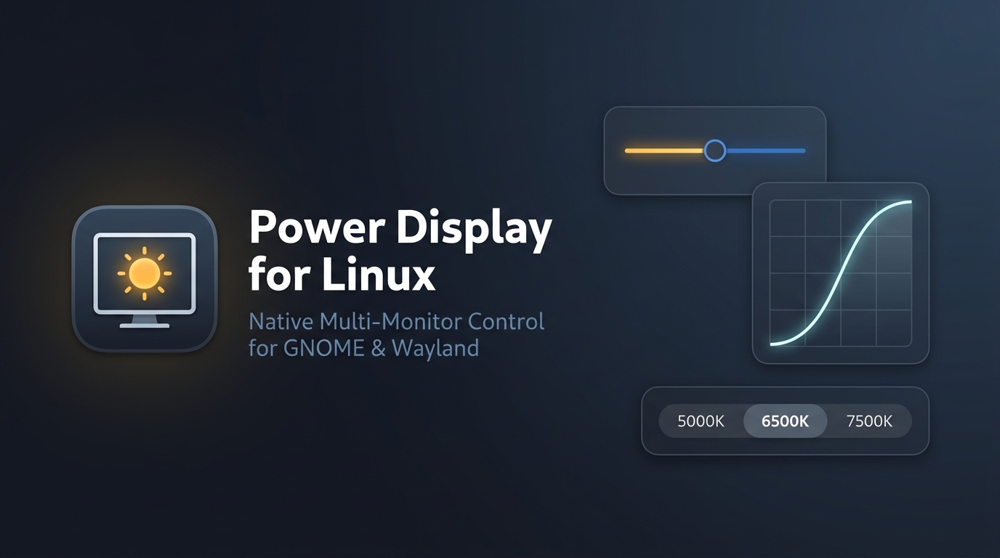
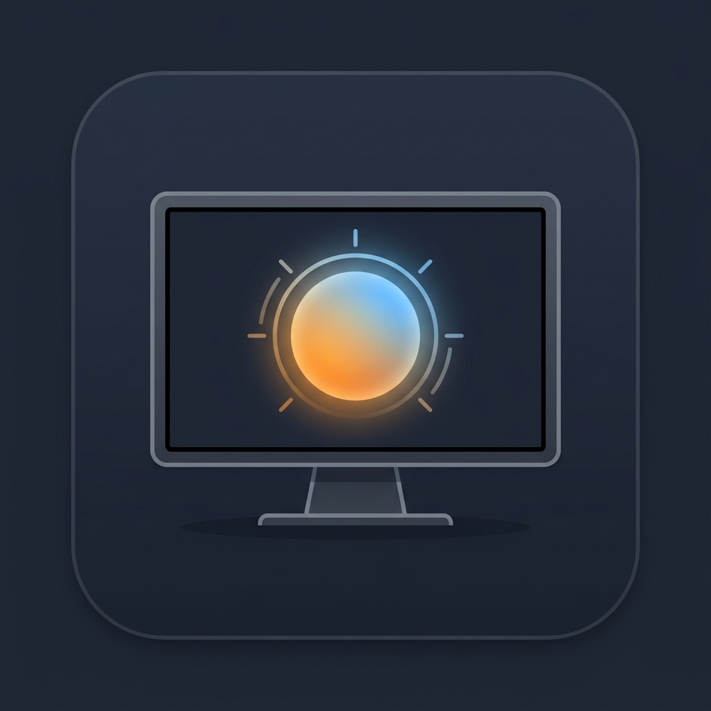
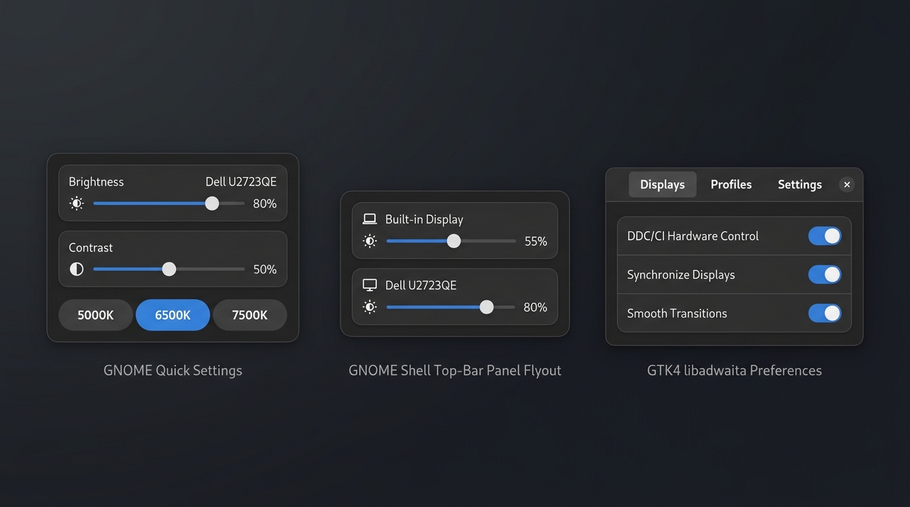

<p align="center">
  
</p>

<h1 align="center">Power Display for Linux (<code>pdfl</code>)</h1>

<p align="center">
  <strong>Native GNOME Shell 50 &amp; GTK4 / libadwaita Multi-Monitor Control for Wayland</strong><br/>
  Hardware DDC/CI brightness, contrast, volume, color temperature, input switching, internal backlight, profiles &amp; safe rotation.
</p>

<p align="center">
  <a href="https://github.com/YasCay/pdfl/actions/workflows/ci.yml"></a>
  <a href="LICENSE"></a>
  
  
</p>

---

**Power Display for Linux (`pdfl`)** brings the clean workflow of *Microsoft PowerToys Power Display* natively into the GNOME / Adwaita desktop — backed by a session D-Bus daemon, hardware-verified capability gating, atomic XDG configuration, and safe Wayland DisplayConfig integration.



## Documentation

- [Feature Parity Matrix (PowerToys Power Display vs. `pdfl`)](docs/PARITY.md)
- [Architecture &amp; D-Bus Interface](docs/ARCHITECTURE.md)
- [Security Policy &amp; Threat Model](SECURITY.md)
- [Contributing Guide](CONTRIBUTING.md)
- [License (MIT)](LICENSE) &amp; [Third-Party Notices](THIRD_PARTY_NOTICES.md)

---

## Key Features

- **GNOME Shell 50 Quick Settings &amp; Panel Extension (`pdfl@yascay.github.io`)**:
  - Dedicated external-monitor brightness slider and DDC/CI status row directly inside GNOME Quick Settings, complete with contrast slider, color-preset buttons, and 1-click default reset when in software mode.
  - Compact, keyboard-accessible top-bar flyout (`<Super><Alt>d` or click) with per-monitor sliders, optional **Linked Brightness**, profile switcher, monitor rescan, and optional mouse-wheel scrolling.
  - Non-blocking asynchronous D-Bus client (`Gio.DBusProxy`) with hover tooltips and calm informational notices instead of false error banners.
- **GTK4 / libadwaita Settings &amp; Profile Manager (`pdfl-settings`)**:
  - Dedicated **Displays**, **Profiles**, and **Settings** tabs.
  - Per-monitor flyout visibility controls and explicit confirmation dialogs for disruptive actions (`input_source` `0x60`, `power_state` `0xD6`).
  - **VCP Capabilities Diagnostics**: inspect parsed MCCS tables, raw capability strings, DRM connectors, I2C buses, and stable monitor IDs.
  - **Custom VCP Labels** (`0x14`, `0x60`, `0xD6`) globally or per monitor.
  - **Profiles** with stable IDs, explicit display ordering, and optional Light/Dark theme switching via XDG Desktop Portal.
- **Safety-First Design**:
  - **Wayland Rotation Protection**: uses Mutter `ApplyMonitorsConfig` (`method=0` verify, `method=1` temporary apply) with an automatic **15-second safety revert** unless confirmed.
  - **Blackout-Proof Software Fallback (Opt-in)**: optional Mutter `SetOutputCTM` / `SetCrtcGamma` fallback for external monitors behind hubs/docks without DDC/CI replies — featuring a **35% hard minimum luminance floor**, a non-crushing S-curve contrast LUT, anti-compounding baseline extraction, auto-recovery on startup, and a 1-click **Restore Defaults** action.
  - **Hardware-Agnostic Persistent IDs**: temporary `/dev/i2c-N` bus numbers are resolved exclusively at runtime and never stored in profiles or settings.
  - **Zero `sudo`, Zero Hardware Side-Effects in Demo Mode (`--demo`)**.

---

## Quick Start (Safe Demo Mode)

Run directly from the repository without touching real monitors or installing files:

```bash
# 1. Inspect simulated monitors via CLI
./bin/pdfl --demo --direct list

# 2. Launch the GTK4 / libadwaita settings app in demo mode
./bin/pdfl-settings --demo --direct

# 3. Or run daemon + GUI over session D-Bus
./bin/pdfl-daemon --demo &
./bin/pdfl-settings --demo
```

---

## Reversible User Installation (GNOME Shell 50 / Wayland)

Installation is scoped **strictly to your user directories** (`~/.local`, `~/.config`) — no `sudo` and no system or `udev` files modified.

### Install

```bash
# Standard user installation
./scripts/install-user.sh

# Optional: include XDG Autostart for pdfl-daemon
./scripts/install-user.sh --autostart

# Optional: preview target paths without writing files
./scripts/install-user.sh --dry-run
```

Ensure `~/.local/bin` is in your `PATH`.

### Enable

1. Start the background session daemon:
   ```bash
   systemctl --user daemon-reload
   systemctl --user enable --now pdfl-daemon.service
   ```
2. Enable the GNOME Shell extension:
   ```bash
   gnome-extensions enable pdfl@yascay.github.io
   ```
   *Note: On Wayland, GNOME Shell loads newly installed extension files after logging out and back in.*
3. Open **Power Display for Linux** from the app grid or run `pdfl-settings`.

### Uninstall Cleanly

```bash
# Remove binaries, extension, desktop entries, icons, D-Bus & systemd user units
# (preserves saved profiles and settings under ~/.config/pdfl)
./scripts/uninstall-user.sh

# Remove everything including configuration and profiles
./scripts/uninstall-user.sh --purge-config
```

Disable first if running: `gnome-extensions disable pdfl@yascay.github.io` and `systemctl --user disable --now pdfl-daemon.service`.

---

## Hardware &amp; System Notes (Linux / Wayland)

- **External Monitors (`ddcutil 2.2.5`)**:
  - Requires kernel module `i2c-dev` and user read/write access to `/dev/i2c-*` (typically via membership in the `i2c` group or distro `udev` rules).
  - `pdfl` never invokes `sudo` or edits system permissions. Bus locks (`flock`), permission errors, or unresponsive DDC/CI ports are surfaced clearly in the UI and CLI.
  - Some USB-C hubs, docks, or KVM switches block DDC/CI (`EREMOTEIO` on `0x37`). Enabling **Software Dimming Fallback** in Settings unlocks Mutter GPU brightness, contrast, and color temperature controls for affected external displays.
- **Internal Laptop Displays (`/sys/class/backlight`)**:
  - Uses `org.gnome.Mutter.DisplayConfig.SetBacklight`, `brightnessctl`, or writable sysfs. When inactive (e.g., laptop lid closed) or read-only, internal displays show a calm status notice and never fall back to software gamma dimming.
- **Conservative Defaults**:
  - `restore_on_launch`, `software_dimming_fallback`, `mouse_wheel_mode`, `theme_profile_switching_enabled`, flyout color temperature, and flyout power control are all disabled by default.

---

## CLI Examples

```bash
pdfl --demo --direct status
pdfl --demo --direct set demo:ddc:DEL:U2723QE:CN04K921 brightness 80
pdfl --demo --direct set demo:ddc:DEL:U2723QE:CN04K921 input 0x11 --confirm
pdfl --demo --direct linked on
pdfl --demo --direct linked set 60
pdfl --demo --direct profile create "Work"
pdfl --demo --direct profile apply "Work"
```

---

## Verification &amp; CI

Run the full automated verification suite locally (no hardware access required):

```bash
node --check extension/pdfl@yascay.github.io/*.js
glib-compile-schemas --strict --dry-run extension/pdfl@yascay.github.io/schemas
desktop-file-validate data/applications/io.github.yascay.pdfl.desktop
python3 -m unittest discover -s tests -v
```
