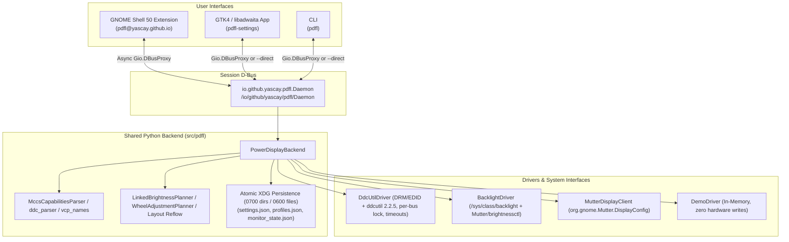

# Architecture of Power Display for Linux (`pdfl`)

## Component Overview

## Stable Monitor IDs vs. Ephemeral Runtime Handles

Transient Linux I2C bus numbers (`/dev/i2c-4`) and `ddcutil` display indices can change across reboots or hotplug events and are **never** persisted in `profiles.json` or `settings.json`.

- **Persistent Monitor ID**:
  - External DDC/CI / DRM: `ddc:<MFG>:<MODEL>:<SERIAL>`, or fallback `edid-<sha256[:12]>` / `<connector>`
  - Internal panel: `internal:<connector>:<vendor>:<product>`
- **Ephemeral Runtime Handle (`MonitorRuntimeHandle`)**:
  - Holds `bus_number`, `ddc_display_num`, `connector`, and `sysfs_path` solely in memory and is freshly resolved on every `rescan()`.

## Session D-Bus Interface (`io.github.yascay.pdfl.Daemon`)

Methods:
- `Ping() -> (s version)`
- `GetState() -> (s state_json)`
- `Rescan() -> (s state_json)`
- `SetFeature(s monitor_id, s feature, i value, b confirmed, b debounce) -> (s result_json)`
- `SetLinkedMode(b enabled) -> (s state_json)`
- `SetLinkedBrightness(i percent, b debounce) -> (s result_json)`
- `StepBrightness(i delta, s mode_override) -> (s result_json)`
- `RequestRotation(s monitor_id, i degrees) -> (s result_json)`
- `ConfirmRotation(s token) -> (s result_json)`
- `RevertRotation(s token) -> (s result_json)`
- `ApplyProfile(s profile_id_or_name) -> (s result_json)`
- `GetSettings() -> (s settings_json)` / `SaveSettings(s settings_json) -> (s saved_json)`
- `GetProfiles() -> (s profiles_json)` / `SaveProfile(s profile_json) -> (s saved_json)`
- `DeleteProfile(i profile_id) -> (b deleted)` / `ReorderProfile(i profile_id, i delta) -> (s profiles_json)`
- `OpenSettings(s page) -> (b launched)` (validated against strict allowlist `displays | profiles | settings`)

Signals:
- `StateChanged(s state_json)`
- `ErrorOccurred(s monitor_id, s message)`
- `RotationPending(s pending_json)`
